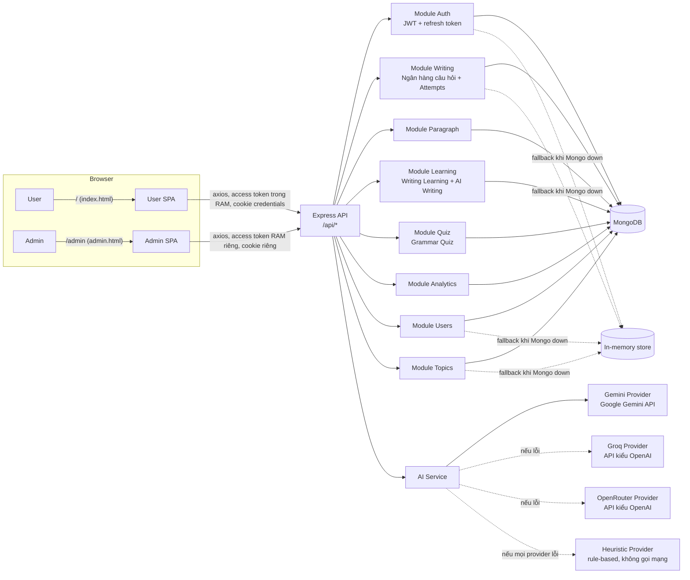

# 01 — Tổng quan hệ thống

> Quy ước dùng xuyên suốt bộ tài liệu này: **[IMPLEMENTED]** = đã xác minh có thật trong source code. **[PARTIAL]** = có code nhưng chưa hoàn chỉnh, chưa được dùng, hoặc chỉ nối một phần. **[NOT IMPLEMENTED]** = không tìm thấy implementation nào trong codebase.

## Hệ thống này là gì

**AI English Writing** là nền tảng web giúp người học tiếng Việt luyện viết tiếng Anh, có tích hợp AI để tự sinh đề luyện tập và tự động chấm bài. Tên trong `package.json` gốc (`real-estate-backend`) chỉ là tàn dư từ template ban đầu của dự án, không liên quan gì đến sản phẩm hiện tại — ứng dụng thực tế, được xác minh xuyên suốt `src/` và `client/src/`, chính là nền tảng luyện viết tiếng Anh mô tả trong tài liệu này.

## Đối tượng sử dụng

- **Học viên (User)** — đăng ký, luyện viết câu và đoạn văn tiếng Anh, nhận phản hồi từ AI, theo dõi tiến độ.
- **Quản trị viên (Admin)** — quản lý ngân hàng câu hỏi, đề viết đoạn văn, nội dung Writing Learning, tài khoản người dùng, và giám sát toàn bộ lượt chấm bài AI của mọi học viên.

Hệ thống chỉ có đúng 2 vai trò: `"user"` và `"admin"` (`src/types/index.ts` → `UserRole`). Không có vai trò nào khác.

## Vấn đề hệ thống giải quyết

Việc tự học viết tiếng Anh thường thiếu người kiểm tra câu/đoạn văn và giải thích tại sao sai. Hệ thống này đóng vai trò thay thế giáo viên đó: cung cấp đề luyện phân cấp độ (từ ngân hàng câu hỏi đã biên soạn sẵn, hoặc do AI sinh theo yêu cầu về chủ đề/thì/cấp độ mà học viên chọn), nhận câu trả lời tiếng Anh của học viên, và trả về một bản nhận xét có cấu trúc, bằng tiếng Việt (điểm số, phân tích theo từng tiêu chí, danh sách lỗi cụ thể kèm cách sửa, điểm mạnh, khuyến nghị) — được một LLM thật sự sinh ra, không phải phản hồi dựng sẵn.

## Các chức năng chính (đã xác minh trong code)

| Chức năng | Trạng thái |
|---|---|
| Đăng ký / Đăng nhập (User), Đăng nhập riêng (Admin) | [IMPLEMENTED] |
| Duyệt Ngân hàng câu hỏi + luyện trực tiếp 1 câu | [IMPLEMENTED] |
| AI Writing (chọn chủ đề/cấp độ/thì → AI sinh đề câu → AI chấm câu trả lời) | [IMPLEMENTED] |
| Writing Learning (19 chủ đề: 12 thì ngữ pháp + 7 chủ đề kỹ năng viết, mỗi chủ đề có tab Learn/Examples/Practice/AI Writing/Progress) | [IMPLEMENTED] |
| Viết đoạn văn (AI sinh đề đoạn văn theo chủ đề/độ khó, AI chấm đoạn văn, lưu lịch sử các lần sửa) | [IMPLEMENTED] |
| Grammar Quiz (AI sinh 10–50 câu trắc nghiệm theo thì/cấp độ/chủ đề, chấm ở server, lịch sử và thống kê) | [IMPLEMENTED] — chỉ chạy khi có MongoDB |
| Viết lại và so sánh các lần nộp của cùng một câu hỏi; liên kết từ kết quả chấm sang ôn lý thuyết/làm quiz đúng thì | [IMPLEMENTED] |
| Card "Gợi ý" (từ vựng/ngữ pháp) gấp mở cho từng câu hỏi, không lộ đáp án | [IMPLEMENTED] |
| Thống kê: tổng số, điểm trung bình, streak, thống kê Quiz, chẩn đoán điểm yếu AI (chỉ chạy khi học viên bấm nút) | [IMPLEMENTED] |
| Admin: quản lý người dùng, CRUD ngân hàng câu hỏi, CRUD đề đoạn văn, CRUD nội dung Writing Learning, tra cứu cấp độ CEFR, lịch sử chấm bài AI hợp nhất, dashboard thống kê hệ thống | [IMPLEMENTED] |
| Chuỗi AI dự phòng nhiều tầng Gemini → Groq → OpenRouter → Heuristic, sắp xếp lại được bằng `AI_PRIMARY_ORDER` | [IMPLEMENTED] — xem [11-ai-system.md](11-ai-system.md) |
| RAG / vector search / embeddings | [NOT IMPLEMENTED] — không có vector DB, embedding model, hay code retrieval nào trong toàn bộ repo. |
| Multi-tenant / tổ chức | [NOT IMPLEMENTED] |

## Công nghệ sử dụng

**Frontend** — React 19 + TypeScript, Vite 8 (2 entry build — xem mục 04), Tailwind CSS 4, React Router 7, `@tanstack/react-query` 5 (dùng ở phần lớn nhưng không phải tất cả các trang lấy dữ liệu — xem mục 06), `axios`, icon `lucide-react`. Không dùng thư viện state management (Redux/zustand) hay thư viện biểu đồ nào; dependencies của client được giữ tối thiểu (xem `client/package.json`).

**Backend** — Node.js + Express 5 + TypeScript, Mongoose 9 (ODM cho MongoDB), `zod` để validate request, `bcryptjs` để hash mật khẩu, `jsonwebtoken` cho access token, `cookie-parser` + `helmet` + `cors` + `morgan` làm middleware Express.

**Database** — MongoDB, kết nối qua `MONGODB_URI` (`src/config/database.ts`). Nếu biến này chưa cấu hình hoặc không kết nối được, phần lớn module sẽ tự động chuyển sang lưu trữ tạm trong bộ nhớ tiến trình (`src/db/memoryStore.ts`), được seed cùng nội dung mẫu như MongoDB — xem [09-database-design.md](09-database-design.md). Riêng module Viết đoạn văn, Writing Learning và Grammar Quiz chỉ hoạt động khi có Mongo, nếu không sẽ báo lỗi thân thiện bằng tiếng Việt.

**AI provider** — chuỗi failover **Gemini → Groq → OpenRouter → Heuristic**. Gemini gọi qua SDK `@google/genai` (`GeminiProvider`); Groq và OpenRouter là 2 provider dự phòng gọi API kiểu OpenAI bằng `fetch` (chỉ được dùng nếu có `GROQ_API_KEY`/`OPENROUTER_API_KEY`); `HeuristicProvider` là bộ quy tắc chạy hoàn toàn nội bộ, không gọi mạng, chỉ dùng khi mọi provider AI đều lỗi hoặc chưa cấu hình. Chi tiết đầy đủ tại [11-ai-system.md](11-ai-system.md).

**Authentication** — Cặp JWT access token + refresh token dạng chuỗi ngẫu nhiên tự sinh, refresh token đặt trong cookie HttpOnly, access token chỉ giữ trong bộ nhớ (RAM) phía client. Chi tiết đầy đủ tại [08-authentication-and-authorization.md](08-authentication-and-authorization.md).

**Deployment** — `deploy.sh`: git pull → `npm ci`/`npm install` → `npm run build` (build 2 bundle Vite của client, sau đó `tsc` biên dịch backend sang `dist/`) → tiến trình PM2 (`ai-english-writing`) chạy `npm start` (`node dist/server.js`). Một tiến trình Express duy nhất phục vụ cả API lẫn 2 bundle SPA đã build. Không tìm thấy file cấu hình Nginx/reverse-proxy nào trong repo — xem [20-deployment-and-runtime.md](20-deployment-and-runtime.md).

## Kiến trúc tổng quan

Xem [04-system-architecture.md](04-system-architecture.md) để có sơ đồ luồng request theo tầng (React → API service → Express route → Controller → Service → Model → MongoDB) và ghi chú kiến trúc theo từng hệ thống con.

## Nên đọc tiếp ở đâu

- Mới vào dự án? Bắt đầu từ [21-system-summary.md](21-system-summary.md).
- Muốn hiểu nghiệp vụ/góc nhìn người dùng? [02-business-requirements.md](02-business-requirements.md), [06-user-features.md](06-user-features.md), [07-admin-features.md](07-admin-features.md).
- Muốn hiểu sâu về AI? [11-ai-system.md](11-ai-system.md) đến [13-ai-paragraph-generation.md](13-ai-paragraph-generation.md) — phần chi tiết nhất trong bộ tài liệu này, theo đúng yêu cầu.
- Cần sửa một chức năng? Xem bảng "muốn sửa cái gì thì sửa file nào" tại [19-file-responsibility-map.md](19-file-responsibility-map.md).
