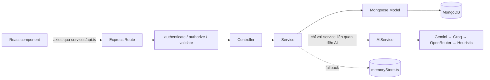

# 04 — Kiến trúc hệ thống (System Architecture)

## Hai frontend, một backend

`client/vite.config.ts` build ra **2 bundle riêng biệt** từ một project Vite duy nhất:

```ts
build.rollupOptions.input = {
  main: 'index.html',   // User Portal
  admin: 'admin.html',  // Admin Portal
}
```

Mỗi entry HTML nạp một React root khác nhau: `client/src/main.tsx` (mount `<App/>` → `AppRoutes.tsx`, User Portal) và `client/src/admin/main.tsx` (mount một `<AdminApp/>` độc lập với cây `<Routes>` riêng, Admin Portal). Đây thực sự là hai module graph JavaScript riêng biệt — `AuthContext` riêng, `QueryClient` riêng, biến access-token trong RAM riêng (mỗi bundle import bản sao riêng của `client/src/services/api.ts`).

Việc định tuyến giữa 2 portal diễn ra **ở phía server**, trong [src/app.ts](../../src/app.ts): Express phục vụ tĩnh thư mục `client/dist/` đã build, và với mọi path không phải `/api`, nó kiểm tra `req.path.startsWith('/admin')` — nếu đúng thì trả `admin.html`, ngược lại trả `index.html`. Đây chính là cách định tuyến thật ở production; không có dev server riêng cho bundle Admin.

```mermaid
flowchart TB
    subgraph "client/ (Vite, 2 entry)"
        IdxHTML[index.html] --> MainTsx[main.tsx] --> App[App.tsx] --> UserRoutes[AppRoutes.tsx]
        AdminHTML[admin.html] --> AdminMainTsx[admin/main.tsx] --> AdminRoutes["Cây Routes (inline)"]
    end
    subgraph "src/ (Express, một tiến trình)"
        AppTs[app.ts] -->|"/api/*"| Routers[Các module router]
        AppTs -->|"path bắt đầu bằng /admin"| AdminHTMLServe[trả admin.html]
        AppTs -->|"mọi trường hợp khác"| IdxServe[trả index.html]
    end
    Browser -->|GET /| AppTs
    Browser -->|GET /admin| AppTs
    UserRoutes -->|axios /api/*| Routers
    AdminRoutes -->|axios /api/*| Routers
```



## Luồng request theo tầng (backend)

Mọi module backend (`auth`, `users`, `topics`, `writing`, `ai`, `analytics`, `paragraph`, `learning`, `quiz`) đều theo cùng một cấu trúc file và phân tầng, không có ngoại lệ nào trong codebase:

```
Route (*.route.ts)
  → Middleware (authenticate / authorize / validate / aiRateLimiter, tùy route)
    → Controller (*.controller.ts) — parse req, gọi đúng 1 method của service, bọc kết quả bằng ApiResponse
      → Service (*.service.ts) — toàn bộ logic nghiệp vụ, truy vấn DB, gọi AI đều nằm ở đây
        → Model (*.model.ts, Mongoose) — schema + lưu trữ
          → MongoDB
        (hoặc → src/db/memoryStore.ts, mảng lưu trong bộ nhớ, khi Mongo chưa kết nối)
```



Controller không bao giờ đụng trực tiếp vào Mongoose hay AI service; service không bao giờ đụng vào `req`/`res`. Mọi method controller đều theo đúng một khuôn mẫu: `try { const result = await xService.method(...); ApiResponse.success(res, result, message); } catch (e) { ApiResponse.error(res, e.message, statusCode); }` — một khuôn mẫu response duy nhất, nhất quán (`{ success, message, data }` hoặc `{ success: false, message, errors }`) từ [src/utils/apiResponse.ts](../../src/utils/apiResponse.ts).

## Kiến trúc module

Mỗi domain trong `src/modules/<name>/` sở hữu `*.route.ts`, `*.controller.ts`, `*.service.ts`, `*.model.ts` (nếu module có dữ liệu lưu trữ) riêng, và `*.validation.ts` (schema Zod, nếu module nhận input ghi). Gọi chéo giữa các module chỉ xảy ra ở tầng service (ví dụ `learning.service.ts` import trực tiếp `analyticsService`, `WritingAttemptModel`, `ParagraphAttemptModel`, `aiService`) — không bao giờ gọi qua HTTP tới chính mình. Không có message bus, không có event system, không có background job runner ở bất kỳ đâu trong codebase.

## Kiến trúc database

Cơ chế dual-mode chủ đích (xem [09-database-design.md](09-database-design.md) để có danh sách model đầy đủ): mọi service đọc/ghi nội dung học tập cốt lõi đều kiểm tra `mongoose.connection.readyState === 1` và rẽ nhánh giữa gọi Mongoose và một thao tác tương đương trên `memoryStore` (singleton mảng thuần). Có 3 module — **Viết đoạn văn**, **Writing Learning** và **Grammar Quiz** — chủ động không theo mẫu dual-mode này (`assertMongo()` sẽ ném lỗi thân thiện bằng tiếng Việt thay vào đó) vì cấu trúc dữ liệu lồng nhau phức tạp hơn của chúng (lịch sử các lần sửa, examples/mistakes, bộ câu hỏi kèm đáp án) bị đánh giá là không đáng để cài lại tương đương trên in-memory store.

## Kiến trúc AI

Chi tiết đầy đủ tại [11-ai-system.md](11-ai-system.md). Tóm tắt trong một câu: mọi service phụ thuộc AI đều gọi qua một object `aiService` duy nhất, object này dựng lúc khởi động một **chuỗi provider** theo thứ tự Gemini → Groq → OpenRouter (chỉ gồm những provider đã có API key, sắp xếp lại được bằng `AI_PRIMARY_ORDER`), thử lần lượt từng provider đúng 1 lần, provider nào thành công thì dừng, và chỉ khi mọi provider đều lỗi mới chạy lại đúng lệnh gọi đó với Heuristic provider (không gọi mạng) trước khi thực sự thất bại.

## Kiến trúc Authentication

Chi tiết đầy đủ tại [08-authentication-and-authorization.md](08-authentication-and-authorization.md). Tóm tắt trong một câu: một `authService` không phân biệt vai trò phát hành access token JWT (trả về trong JSON body, giữ trong RAM ở client) và refresh token dạng chuỗi ngẫu nhiên (đặt trong cookie HttpOnly, hash rồi lưu ở server); User Portal và Admin Portal gọi các endpoint có cấu trúc giống hệt nhau nhưng khác đường dẫn (`/auth/*` so với `/auth/admin/*`) để cookie (`user_refresh_token` so với `admin_refresh_token`) và token trong RAM của 2 bên không bao giờ va chạm nhau.

## Kiến trúc API

REST-ish JSON qua HTTP, mount dưới `/api` trong `app.ts`:

```
/api/auth        → auth.route.ts
/api/users       → user.route.ts
/api, /api/topics → topic.route.ts   (mount 2 lần, xem 10-api-documentation.md)
/api/writing     → writing.route.ts
/api/ai          → ai.route.ts
/api/analytics   → analytics.route.ts
/api/paragraph   → paragraph.route.ts
/api/learning    → learning.route.ts
/api/quiz        → quiz.route.ts
```

Không có GraphQL, không có gRPC, không có kênh WebSocket/real-time nào trong codebase — [NOT IMPLEMENTED].

## Kiến trúc Frontend

- **State**: React Context (`AuthContext`, tham số hóa qua prop `portal: 'user' | 'admin'`) cho identity; `@tanstack/react-query` để cache/invalidate server-state ở phần lớn (không phải tất cả) các trang lấy dữ liệu; `useState` thuần ở mọi nơi còn lại. Không có Redux hay thư viện state management nào khác.
- **Routing**: `react-router-dom` v7, layout route lồng nhau (`UserLayout`/`AdminLayout` bọc `<Outlet/>`).
- **Styling**: class tiện ích Tailwind CSS v4 viết trực tiếp trong JSX; không dùng CSS-in-JS, không dùng thư viện component (`lucide-react` chỉ để lấy icon).
- **HTTP**: một instance `axios` dùng chung cho mỗi bundle ([client/src/services/api.ts](../../client/src/services/api.ts)) với request interceptor (gắn access token đang giữ trong RAM) và response interceptor (khi gặp 401, âm thầm đổi lại access token qua cookie refresh một lần rồi gọi lại request gốc; nếu thất bại, phát ra một event `window` mà `AuthContext` lắng nghe để xóa state phiên đăng nhập).
