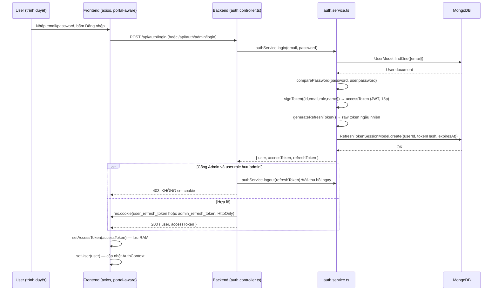

# 08 — Authentication & Authorization

Đây là phần quan trọng bậc nhất của hệ thống về mặt bảo mật — tài liệu này mô tả chính xác từng bước dựa trên code thực tế, không suy đoán.

## Danh sách file liên quan

| Vai trò | File |
|---|---|
| JWT utility (ký/verify access token, tạo/hash refresh token) | [src/utils/jwt.ts](../../src/utils/jwt.ts) |
| Password hashing | [src/utils/password.ts](../../src/utils/password.ts) |
| Auth service (logic nghiệp vụ, không phân biệt vai trò) | [src/modules/auth/auth.service.ts](../../src/modules/auth/auth.service.ts) |
| Auth controller (cookie, tách theo portal) | [src/modules/auth/auth.controller.ts](../../src/modules/auth/auth.controller.ts) |
| Auth routes | [src/modules/auth/auth.route.ts](../../src/modules/auth/auth.route.ts) |
| User model | [src/modules/users/user.model.ts](../../src/modules/users/user.model.ts) |
| Refresh token model | [src/modules/auth/refreshToken.model.ts](../../src/modules/auth/refreshToken.model.ts) |
| Auth middleware (authenticate, authorize) | [src/middlewares/auth.middleware.ts](../../src/middlewares/auth.middleware.ts) |
| Frontend Auth Context (dùng chung cho cả 2 portal) | [client/src/context/AuthContext.tsx](../../client/src/context/AuthContext.tsx) |
| API interceptor (access token, tự refresh khi 401) | [client/src/services/api.ts](../../client/src/services/api.ts) |
| Protected route (User) | [client/src/routes/ProtectedRoute.tsx](../../client/src/routes/ProtectedRoute.tsx), [UserRoute.tsx](../../client/src/routes/UserRoute.tsx) |
| Protected route (Admin) | [client/src/routes/AdminProtectedRoute.tsx](../../client/src/routes/AdminProtectedRoute.tsx) |

## Register (Đăng ký)

`POST /api/auth/register` → `auth.controller.ts#register` → `auth.service.ts#register`:
1. Chuẩn hóa email (`toLowerCase().trim()`), kiểm tra trùng.
2. Hash mật khẩu bằng `bcrypt.hash(password, salt)` (`genSalt(10)`).
3. Tạo `User` với `role: "user"` cứng (không nhận role từ input — không thể tự đăng ký thành admin), `dailyGoal: 5`, `streak: 0`.
4. Phát hành token pair (xem mục "Phát hành token" bên dưới), set cookie `user_refresh_token`.

## Login (Đăng nhập)

`POST /api/auth/login` → `auth.service.ts#login`:
1. Tìm user theo email, kiểm tra `isActive`.
2. So khớp mật khẩu bằng `bcrypt.compare`.
3. Phát hành token pair, set cookie `user_refresh_token`.

## Access Token

- Ký bằng `jsonwebtoken`, secret = `JWT_SECRET` (biến môi trường, có fallback hardcode cho môi trường dev), payload `{ id, email, role, name }`.
- Thời hạn: `JWT_EXPIRES_IN`, mặc định **15 phút**.
- Gửi về Frontend trong JSON body (không phải cookie).
- **Lưu ở đâu**: chỉ trong RAM — một biến `let accessToken` ở scope module trong `client/src/services/api.ts`, **không bao giờ ghi vào `localStorage`/`sessionStorage`**. Mỗi request gắn `Authorization: Bearer <token>` qua request interceptor của `axios`.
- Vì chỉ ở RAM, token **mất khi F5/đóng tab** — đây là lý do bắt buộc phải có bước "bootstrap session" (xem bên dưới).

## Refresh Token

- Chuỗi ngẫu nhiên (không phải JWT): `crypto.randomBytes(48).toString("hex")`.
- Chỉ **hash** của nó (HMAC-SHA256 với secret `REFRESH_TOKEN_SECRET`) được lưu trong DB (collection `refresh_token_sessions`, model `RefreshTokenSessionModel`) — token thật không bao giờ chạm database, nên rò rỉ DB không đồng nghĩa với rò rỉ token dùng được.
- Token thật (raw) được gửi về client dưới dạng cookie **HttpOnly** (`httpOnly: true`, `secure: NODE_ENV==='production'`, `sameSite: 'lax'`, `path: '/api/auth'`, `maxAge` = `REFRESH_TOKEN_EXPIRES_IN_DAYS` ngày, mặc định 30 ngày) — JavaScript phía client **không thể đọc** cookie này, chỉ trình duyệt tự động gửi kèm khi gọi `/api/auth/*` với `withCredentials: true`.
- **Refresh token rotation**: mỗi lần `refresh()` được gọi, session cũ bị đánh dấu `revokedAt` và một token mới được phát hành + set cookie mới — token refresh cũ không dùng lại được lần thứ hai (`auth.service.ts#refresh`).
- **Refresh token session**: mỗi lần đăng nhập/refresh tạo một document `RefreshTokenSession { userId, tokenHash, expiresAt, revokedAt?, userAgent }` — đây chính là cơ chế cho phép "đăng xuất" thu hồi đúng một phiên cụ thể mà không ảnh hưởng phiên khác.

## Password Hashing

`bcryptjs`, cost factor 10 (`bcrypt.genSalt(10)`), thực hiện ở `src/utils/password.ts`. Trường `password` luôn bị loại khỏi mọi response (`.select("-password")` hoặc destructure thủ công) ở tầng service.

## Role Authorization

Xem [03-user-roles-and-permissions.md](03-user-roles-and-permissions.md) để có bảng đầy đủ. Tóm tắt: `authenticate` xác thực danh tính + tái kiểm `isActive`; `authorize("admin")` kiểm tra `req.user.role`.

## Protected Routes (Frontend)

Xem [03-user-roles-and-permissions.md](03-user-roles-and-permissions.md) mục "Cơ chế bảo vệ ở Frontend" — không lặp lại ở đây để tránh trùng lặp/lệch thông tin.

---

## PHẦN QUAN TRỌNG NHẤT: Vì sao User Portal và Admin Portal có phiên đăng nhập độc lập hoàn toàn

Đây là kết quả của một lần sửa lỗi có chủ đích trong dự án: trước đây User và Admin **dùng chung** endpoint `/api/auth/login|refresh|logout` và **dùng chung một cookie** `refreshToken` — ai đăng nhập sau cùng sẽ "ghi đè" phiên của người kia, gây ra hiện tượng mở 2 tab (một tab User, một tab Admin) rồi F5 có thể khiến một tab "biến thành" giao diện của tab kia.

### Cách khắc phục — tách theo 2 trục độc lập

**1. Tách endpoint + tách cookie (backend, không đổi kiến trúc JWT)**

`auth.controller.ts` định nghĩa 2 tên cookie khác nhau:
```ts
const USER_REFRESH_COOKIE_NAME = "user_refresh_token";
const ADMIN_REFRESH_COOKIE_NAME = "admin_refresh_token";
```
- User: `POST /auth/register|login|refresh|logout` → luôn đọc/ghi cookie `user_refresh_token`.
- Admin: `POST /auth/admin/login|refresh|logout` (route mới, khai báo trong `auth.route.ts`) → luôn đọc/ghi cookie `admin_refresh_token`.

Cả 3 method Admin đều **tái sử dụng nguyên vẹn** `authService.login()`/`authService.refresh()`/`authService.logout()` — không viết lại logic JWT/hash mật khẩu, chỉ khác ở:
- `adminLogin`: sau khi `authService.login()` thành công, nếu `user.role !== "admin"` thì **thu hồi ngay phiên vừa phát hành** (`authService.logout(refreshToken)`) và trả 403 **mà không set cookie** — một tài khoản không phải admin không bao giờ để lại refresh-token session còn dùng được qua cổng này.
- `adminRefresh`: cùng logic phòng thủ — nếu tài khoản bị hạ quyền sau khi cookie đã tồn tại, lần refresh kế tiếp sẽ bị từ chối + xóa cookie.

**2. Tách Context ở Frontend bằng một prop, không tách file**

`AuthContext.tsx` nhận thêm prop `portal?: 'user' | 'admin'` (mặc định `'user'`), dùng để chọn đúng bộ endpoint:
```ts
const ENDPOINTS = {
  user:  { login: '/auth/login',       refresh: '/auth/refresh',       logout: '/auth/logout' },
  admin: { login: '/auth/admin/login', refresh: '/auth/admin/refresh', logout: '/auth/admin/logout' },
};
```
`App.tsx` (bundle User) dùng `<AuthProvider portal="user">`; `admin/main.tsx` (bundle Admin) dùng `<AuthProvider portal="admin">`. Vì đây vốn là 2 bundle Vite tách biệt (xem [04](04-system-architecture.md)), mỗi bundle vốn đã có **module instance riêng** của `AuthContext.tsx` và `services/api.ts` — nghĩa là biến `accessToken` trong RAM của User và của Admin **chưa bao giờ** là cùng một biến, kể cả trước khi sửa lỗi. Vấn đề thực sự chỉ nằm ở cookie dùng chung + các đường điều hướng chéo portal (xem bên dưới).

**3. Xóa mọi đường điều hướng chéo portal**

Rà soát phát hiện các lỗi cụ thể sau (đã sửa):
- `UserRoute.tsx` từng có `if (user?.role === 'admin') return <Navigate to="/admin" replace />;` — nếu phiên User (do cookie dùng chung) nhận diện ra một danh tính admin, nó sẽ tự điều hướng sang `/admin`.
- `AppRoutes.tsx` (bundle User) từng **khai báo trùng toàn bộ cây route `/admin/*`** ngay bên trong bundle User — khiến điều hướng ở trên render ra UI Admin thật sự **ngay trong tab User**, không cần tải lại trang.
- `AdminProtectedRoute.tsx` từng dùng `window.location.replace('/dashboard')` (một path của User) khi phát hiện tài khoản không phải admin, và chuyển hướng người chưa đăng nhập tới `/login` (path User) thay vì `/admin/login`.
- `SignIn.tsx` từng có link "Đăng nhập tài khoản Admin" và tự điều hướng `/admin` nếu tài khoản đăng nhập có role admin.
- `AdminLoginPage.tsx` từng xác thực (ghi state Context) trước rồi mới kiểm tra role ở client — một tài khoản không phải admin vẫn bị "đăng nhập" vào Context của bundle Admin dù không điều hướng tiếp.

Tất cả đã được sửa để **mỗi portal chỉ biết về chính nó**: `AppRoutes.tsx` (User) hiện không còn route `/admin` nào; `AdminProtectedRoute` chỉ bao giờ điều hướng về `/admin/login`; `UserRoute` không còn kiểm tra role; đăng nhập Admin dựa hoàn toàn vào việc backend từ chối thẳng tài khoản không phải admin (không cần kiểm tra lại ở client).

### Sơ đồ luồng Login (theo code thực tế)



### Luồng bootstrap khi tải lại trang (F5)

```mermaid
sequenceDiagram
    participant F as Frontend (AuthProvider useEffect)
    participant B as Backend
    participant DB as MongoDB

    Note over F: accessToken trong RAM đã mất sau F5
    F->>B: POST /api/auth/refresh (hoặc /admin/refresh) — trình duyệt tự gửi kèm đúng cookie của portal này
    B->>DB: Tìm RefreshTokenSession theo tokenHash, kiểm tra chưa revoke/chưa hết hạn
    alt Cookie hợp lệ
        B->>DB: Đánh dấu session cũ revokedAt, tạo session mới (rotation)
        B-->>F: 200 { user, accessToken mới } + cookie mới
        F->>F: setAccessToken + setUser → coi như đã đăng nhập
    else Không có cookie / cookie không hợp lệ / hết hạn
        B-->>F: 401
        F->>F: clearSession() → isAuthenticated = false → hiện trang Login của đúng portal này
    end
