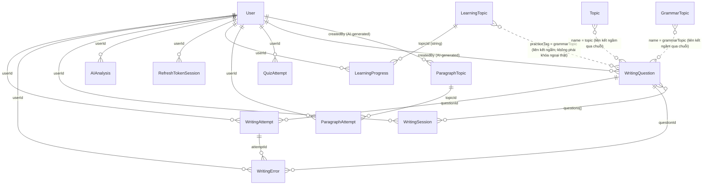

# 09 — Thiết kế Database (Database Design)

Database: **MongoDB**, truy cập qua Mongoose. Toàn bộ 14 model Mongoose dưới đây được đối chiếu trực tiếp với file schema thật trong `src/modules/**/*.model.ts`. Mọi `Schema` đều bật `{ timestamps: true }` (tự sinh `createdAt`/`updatedAt`) trừ khi ghi chú khác.

## Danh sách model

### 1. `User` — collection `users`
**Mục đích**: tài khoản học viên/admin.
File: [src/modules/users/user.model.ts](../../src/modules/users/user.model.ts)

| Field | Type | Required | Default | Ghi chú |
|---|---|---|---|---|
| name | String | ✓ | | |
| email | String | ✓ | | unique, lowercase, index |
| password | String | ✓ | | hash bcrypt |
| role | String enum(`user`,`admin`) | | `"user"` | |
| avatar | String | | `""` | |
| dailyGoal | Number | | `5` | mục tiêu số câu/ngày |
| streak | Number | | `0` | số **ngày liên tiếp** có luyện viết câu; tính bằng `computeNextStreak()` ([src/utils/streak.ts](../../src/utils/streak.ts)) mỗi khi nộp bài Sentence Writing, ngày tính theo múi giờ Việt Nam |
| lastPracticeDate | Date | | | thời điểm nộp bài Sentence Writing gần nhất, dùng để xác định hôm nay có nối tiếp ngày trước không |
| totalWriting | Number | | `0` | tổng lượt Sentence Writing |
| averageScore | Number | | `0` | trung bình cộng dồn theo công thức chạy (rolling average) |
| isActive | Boolean | | `true` | tài khoản bị khóa khi `false` |

### 2. `WritingQuestion` — collection `writingquestions`
**Mục đích**: câu hỏi Sentence Writing (ngân hàng câu hỏi + câu do AI sinh).
File: [src/modules/writing/question.model.ts](../../src/modules/writing/question.model.ts)

| Field | Type | Required | Ghi chú |
|---|---|---|---|
| vietnameseSentence | String | ✓ | đề bài |
| referenceAnswer | String | ✓ | đáp án chuẩn — không bao giờ trả về trước khi submit |
| alternativeAnswers | String[] | | các cách diễn đạt tương đương |
| level | String enum A1–C2 | ✓ | index |
| topic | String | ✓ | index |
| grammarTopic | String | ✓ | index |
| difficulty | String enum(easy,medium,hard) | | mặc định `medium`, index |
| keywords | String[] | | dùng làm fallback cho gợi ý từ vựng |
| isActive | Boolean | | mặc định `true`, index |
| createdBy | Mixed | | id người tạo (admin hoặc user, tùy `source`) |
| source | String enum(`admin_manual`,`ai_user_generated`) | | vắng = câu hỏi Admin biên soạn gốc |
| hints.vocabulary | String[] | | tùy chọn, ưu tiên hơn `keywords` |
| hints.grammar | String | | tùy chọn, ưu tiên hơn bảng tĩnh theo `grammarTopic` |

### 3. `WritingSession` — collection `writingsessions`
**Mục đích**: một phiên luyện gồm nhiều câu hỏi (dùng bởi flow "tạo session N câu" cũ — xem [10](10-api-documentation.md)).
File: [src/modules/writing/session.model.ts](../../src/modules/writing/session.model.ts)

`userId`, `level`, `topic?`, `grammarTopic?`, `difficulty?`, `questions: Mixed[]` (id các câu hỏi), `currentQuestionIndex`, `totalQuestions`, `completedQuestions`, `scoreTotal`, `startedAt`, `completedAt?`, `status` enum(`IN_PROGRESS`,`COMPLETED`,`ABANDONED`).

### 4. `WritingAttempt` — collection `writingattempts`
**Mục đích**: một lượt làm bài Sentence Writing đã được AI chấm.
File: [src/modules/writing/attempt.model.ts](../../src/modules/writing/attempt.model.ts)

`userId`, `sessionId?`, `questionId`, `vietnameseSentence`, `referenceAnswer`, `userAnswer`, `status` enum(`correct`,`partially_correct`,`incorrect`), `aiScore`, `finalScore`, `summary?`, `correctAnswer?`, `alternativeAnswers[]`, `errors[]` (sub-document: type, category?, severity, wrongText, correctText, explanation), `strengths[]`, `weaknesses[]`, `overallFeedback`, `recommendations[]`, `scoreBreakdown { grammar, vocabulary, meaning, sentenceStructure, naturalness }`, `aiProvider?` (tên provider đã chấm: `"gemini"`, `"groq"`, `"openrouter"` hoặc `"heuristic_fallback"`), `level`, `topic`, `grammarTopic`. Mỗi lần nộp bài tạo **một document mới** (không có unique index theo `{userId, questionId}`), nên nộp lại cùng một câu hỏi vẫn giữ nguyên các lần trước.

Index bổ sung: `{userId, createdAt: -1}`, `{userId, questionId}`, `{userId, grammarTopic}` — phục vụ trực tiếp các truy vấn History/Analytics/Weakness.

### 5. `WritingError` — collection `writingerrors`
**Mục đích**: mỗi lỗi được tách thành 1 document riêng (bên cạnh việc lỗi cũng nằm lồng trong `WritingAttempt.errors[]`) để phục vụ thống kê tổng hợp theo loại lỗi/chủ điểm ngữ pháp mà không cần duyệt lại từng attempt.
File: [src/modules/writing/error.model.ts](../../src/modules/writing/error.model.ts)

`userId`, `attemptId`, `questionId`, `type`, `category?`, `severity?`, `wrongText`, `correctText`, `explanation`, `topic`, `grammarTopic`.

### 6. `AIAnalysis` — collection `aianalyses`
**Mục đích**: kết quả chẩn đoán điểm yếu AI đã lưu, mỗi lần chẩn đoán tạo 1 document mới.
File: [src/modules/analytics/analysis.model.ts](../../src/modules/analytics/analysis.model.ts)

`userId`, `overallLevel`, `strengths[]`, `weaknesses[]`, `repeatedErrors[]` (type, category?, frequency, exampleMistake, correction, advice), `progress` enum(`improving`,`stable`,`needs_attention`), `analysis`, `recommendations[]`, `dataSnapshot` (Mixed — chụp lại số liệu đầu vào tại thời điểm chẩn đoán).

### 7. `RefreshTokenSession` — collection `refresh_token_sessions`
**Mục đích**: phiên refresh-token đang hoạt động (xem [08](08-authentication-and-authorization.md)).
File: [src/modules/auth/refreshToken.model.ts](../../src/modules/auth/refreshToken.model.ts)

`userId`, `tokenHash` (unique — HMAC-SHA256 của refresh token thật), `expiresAt` (index), `revokedAt?`, `userAgent?`.

### 8. `Topic` — collection `topics`
**Mục đích**: 15 chủ đề nội dung (Daily Life, Family, Work, ...) dùng chung cho Question Bank, Paragraph Writing, sinh đề AI.
File: [src/modules/topics/topic.model.ts](../../src/modules/topics/topic.model.ts)

`name` (unique), `description`, `icon?`, `isActive`, `order`.

### 9. `GrammarTopic` — collection `grammartopics`
**Mục đích**: 18 chủ điểm ngữ pháp tham khảo, dùng ở Question Bank và Admin Questions.
File: [src/modules/topics/grammar.model.ts](../../src/modules/topics/grammar.model.ts)

`name` (unique), `description`, `level`, `isActive`, `order`.

### 10. `LearningTopic` — collection `learningtopics`
**Mục đích**: 19 chủ đề Writing Learning (12 thì + 7 kỹ năng viết).
File: [src/modules/learning/learning-topic.model.ts](../../src/modules/learning/learning-topic.model.ts)

`slug` (unique), `title`, `titleVi`, `category` enum(`grammar`,`writing_skill`), `description`, `theory` (markdown rút gọn), `examples[]` (english, vietnamese?, explanation), `commonMistakes[]` (wrong, correct, explanation), `practiceTag?` (khớp `grammarTopic` của `WritingQuestion`), `externalPracticePath?`, `cefrLevel?`, `difficulty?`, `order`, `isPublished`, `createdBy?`.

### 11. `LearningProgress` — collection `learningprogresses`
**Mục đích**: tiến độ học theo từng user × từng chủ đề.
File: [src/modules/learning/learning-progress.model.ts](../../src/modules/learning/learning-progress.model.ts)

`userId`, `topicId` (lưu dạng string, không phải ObjectId thật — xem ghi chú trong `learning.service.ts`), `completedSections: string[]` enum(`learn`,`examples`,`practice`,`aiWriting`), `lastAccessedAt`. Unique index `{userId, topicId}`.

### 12. `ParagraphTopic` — collection `paragraphtopics`
**Mục đích**: đề viết đoạn văn (do Admin soạn hoặc AI sinh theo yêu cầu).
File: [src/modules/paragraph/paragraph-topic.model.ts](../../src/modules/paragraph/paragraph-topic.model.ts)

`title`, `instruction`, `levelTier` enum(`Beginner`,`Intermediate`,`Advanced`), `minWords`, `maxWords`, `requirements[]`, `topicCategory?`, `isActive`, `order`, `createdBy?`, `source?` enum(`admin_manual`,`ai_user_generated`).

### 13. `ParagraphAttempt` — collection `paragraphattempts`
**Mục đích**: bài làm đoạn văn của 1 user cho 1 đề, giữ toàn bộ lịch sử các lần nộp lại.
File: [src/modules/paragraph/paragraph-attempt.model.ts](../../src/modules/paragraph/paragraph-attempt.model.ts)

`userId`, `topicId`, `currentUserAnswer`, `currentScore`, `revisions[]` — mỗi phần tử là một lần chấm đầy đủ: `text`, `wordCount`, `score`, `criteria` (7 tiêu chí, mỗi tiêu chí `{score, feedback}`), `errors[]`, `strengths[]`, `weaknesses[]`, `correctedSuggestion`, `overallFeedback`, `aiProvider?` (`"gemini"`, `"groq"`, `"openrouter"` hoặc `"heuristic_fallback"`), `submittedAt`. Giới hạn tối đa **30 revision gần nhất** (`$push` với `$slice: -30` trong `paragraph.service.ts#submitAttempt`). Unique index `{userId, topicId}` — mỗi cặp user+đề chỉ có đúng 1 document (không tạo document mới cho mỗi lần nộp).

### 14. `QuizAttempt` — collection `quizattempts`
**Mục đích**: một bài Grammar Quiz — lưu cả bộ câu hỏi (kèm đáp án đúng và giải thích) lẫn kết quả sau khi nộp. Chỉ dùng khi có Mongo.
File: [src/modules/quiz/quiz-attempt.model.ts](../../src/modules/quiz/quiz-attempt.model.ts)

`userId`, `difficulty` (enum A1–C2), `grammar` (nhãn tóm tắt, ví dụ "Present Simple, Past Simple" hoặc "Tất cả 12 thì" — giữ để tương thích ngược), `tenses[]` (danh sách tên thì thật sự có trong bài), `topic`, `questionCount`, `questions[]` (mỗi phần tử: `questionId` ("q1", "q2"...), `question`, `options[]` (4 đáp án), `correctAnswer` (0–3), `selectedAnswer` (0–3 hoặc null), `isCorrect`, `explanation`, `tense`, `difficulty`, `topic`), `correctCount`, `wrongCount`, `score` (0–100), `status` enum(`generated`,`completed`), `startedAt`, `completedAt?`. Index `{userId, createdAt: -1}`.

Vòng đời: tạo với `status: "generated"` khi sinh quiz (đáp án đúng chỉ nằm trong DB, không gửi về client) → `status: "completed"` khi nộp bài (chấm ở server). Lịch sử và thống kê chỉ tính các bài `completed`.

## Sơ đồ quan hệ (ERD)

**Lưu ý quan trọng về quan hệ**: hệ thống này **không dùng `ref`/`populate` của Mongoose** ở bất kỳ đâu. Mọi "quan hệ" đều là liên kết lỏng qua giá trị chuỗi thô (`userId`, `questionId`, `topicId` đều khai báo kiểu `Schema.Types.Mixed`, không phải `Schema.Types.ObjectId, ref: '...'`) — lý do là các service cần hoạt động y hệt ở cả nhánh Mongo lẫn nhánh `memoryStore` (nơi id chỉ là chuỗi tự sinh dạng `"usr_..."`). Mọi "join" trong service (ví dụ gắn `userName`/`userEmail` vào kết quả `getAllAttemptsAdmin`) đều được viết tay bằng một truy vấn `find({_id: {$in: [...]}})` riêng rồi build `Map` để tra cứu, không dùng `.populate()`.

## Quan hệ giữa các domain chính

- **User ↔ WritingSession ↔ WritingAttempt ↔ WritingError ↔ AIAnalysis**: một user tạo nhiều session (tùy chọn), mỗi session tham chiếu nhiều `WritingQuestion`; mỗi lần nộp bài tạo một `WritingAttempt` (có thể gắn `sessionId` hoặc không, tùy nộp qua flow nào); mỗi lỗi trong `WritingAttempt.errors[]` được nhân bản thành một document `WritingError` riêng để thống kê nhanh; `AIAnalysis` là bản tổng hợp định kỳ từ toàn bộ `WritingAttempt`+`WritingError` của một user.
- **WritingQuestion ↔ Topic/GrammarTopic**: `WritingQuestion.topic`/`.grammarTopic` là **chuỗi tự do** trùng tên với `Topic.name`/`GrammarTopic.name`, không phải id — nghĩa là đổi tên một `Topic`/`GrammarTopic` trong bảng taxonomy sẽ **không** tự động cập nhật các câu hỏi đang tham chiếu tên cũ (rủi ro nhất quán, ghi ở [17](17-admin-management.md)).
- **LearningTopic ↔ WritingQuestion**: liên kết qua `LearningTopic.practiceTag === WritingQuestion.grammarTopic` — cùng lý do chuỗi tự do như trên.
