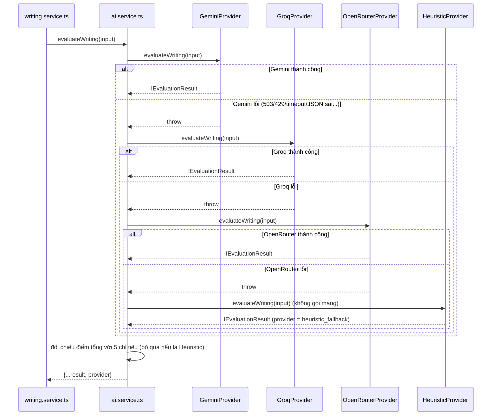

# 11 — Hệ thống AI (AI System)

> Mọi khẳng định dưới đây đều đối chiếu với code hiện tại trong `src/modules/ai/`. Đây là phần tài liệu chi tiết nhất của bộ tài liệu.

## 11.1 Kiến trúc AI tổng thể

```text
Frontend (React)
   ↓ axios POST (vd: /writing/attempts, /paragraph/generate, /quiz/generate, /learning/ai-writing/generate)
Backend API (Controller)
   ↓ gọi đúng 1 method của Service tương ứng module (writing/paragraph/learning/analytics/quiz)
Service (xây "context" — lấy question/topic/user data cần thiết từ DB)
   ↓ gọi aiService.<method>(input đã chuẩn hóa)
AIService (src/modules/ai/ai.service.ts) — KHÔNG tự sinh nội dung, chỉ điều phối
   ↓ runWithFallback(): thử lần lượt từng provider trong chuỗi, mỗi provider tối đa 1 lần
AIProvider Interface (src/modules/ai/ai.interface.ts) — hợp đồng chung, 6 method
   ↓
   ├─→ GeminiProvider          (providers/gemini.provider.ts)        — Google Gemini, SDK @google/genai
   ├─→ GroqProvider            (providers/groq.provider.ts)          ┐ cùng kế thừa
   ├─→ OpenRouterProvider      (providers/openrouter.provider.ts)    ┘ OpenAICompatibleProvider
   │                                (providers/openai-compatible.provider.ts) — gọi `fetch` tới API kiểu OpenAI
   └─→ HeuristicProvider       (providers/heuristic.provider.ts)     — bộ quy tắc cố định, không gọi mạng
```

6 method của `AIProvider`: `generateWritingQuestions`, `evaluateWriting`, `analyzeWeakness`, `evaluateParagraph`, `generateParagraphPrompt`, `generateQuizQuestions`. Cả 4 provider đều cài đủ 6 method, nên `aiService` đổi qua lại giữa chúng mà không cần biết provider nào đang chạy.

### Chuỗi provider (failover)

```text
Gemini  →  Groq  →  OpenRouter  →  Heuristic
```

- Mỗi provider chỉ được đưa vào chuỗi **nếu đã cấu hình key** (Gemini: `AI_PROVIDER=gemini` + `GEMINI_API_KEY`; Groq: `GROQ_API_KEY`; OpenRouter: `OPENROUTER_API_KEY`). Thiếu key thì provider đó bị bỏ qua hoàn toàn, không báo lỗi, không làm sập server.
- Provider nào thành công thì **dừng ngay**, các provider sau không được gọi. Không gọi song song.
- Mỗi provider chỉ được gọi **1 lần** cho mỗi request (không retry lồng nhau giữa các provider).
- `HeuristicProvider` luôn là chốt chặn cuối, không nằm trong danh sách provider cấu hình. Nếu không có provider AI nào được cấu hình, hệ thống chạy thẳng bằng Heuristic.
- Thứ tự mặc định là `gemini,groq,openrouter`, đổi được bằng biến `AI_PRIMARY_ORDER` (ví dụ `groq,gemini,openrouter` khi Gemini đang quá tải). Provider không được liệt kê vẫn được dùng, nối vào sau theo thứ tự mặc định; tên không hợp lệ bị bỏ qua kèm cảnh báo. Biến này chỉ **sắp xếp lại** các provider đã có key, không bật provider chưa có key.

Khi khởi động, `ai.service.ts` log một dòng cho biết chuỗi đang dùng, ví dụ: `[AI Service] AI provider order: gemini → groq → openrouter → heuristic_fallback`.

## 11.2 Pipeline chấm một câu Sentence Writing (`POST /writing/attempts`)

Các luồng AI khác (chấm đoạn văn, sinh câu hỏi, sinh đề đoạn văn, sinh quiz, chẩn đoán điểm yếu) đi theo cùng khuôn mẫu, chỉ khác input/prompt/schema.

| Bước | File | Function | Ghi chú |
|---|---|---|---|
| 1. User input | `WritingQuestionPage.tsx` / `PracticePage.tsx` / `LearningTopicPage.tsx` | `submitMutation` | POST `{questionId, answer}` |
| 2. API | `writing.route.ts` | `POST /attempts` | qua `authenticate`, `aiRateLimiter(60)`, `validate(SubmitAttemptSchema)` |
| 3. Controller | `writing.controller.ts` | `submitAttempt` | chỉ chuyển tiếp |
| 4. Xây context | `writing.service.ts` | `submitAttempt` | gọi `getQuestionById(id, true)` — **chỉ lúc này** mới lấy `referenceAnswer`, ở server |
| 5. Điều phối | `ai.service.ts` | `evaluateWriting` → `runWithFallback` | thử từng provider theo chuỗi |
| 6. Build prompt | `providers/*` | `buildWritingEvaluationPrompt(input)` | cùng một prompt cho mọi provider |
| 7. Gọi LLM | Gemini: `generateJsonWithFallback`; Groq/OpenRouter: `callChatJson` | | xem 11.4 |
| 8. Parse + Validate | provider | `cleanJsonString` → `JSON.parse` → `EvaluationSchema.parse` (Zod) | JSON sai shape thì thử lại (xem 11.5) |
| 9. Chuẩn hóa | provider | | trả `IEvaluationResult` kèm `scoreBreakdown` gộp từ 5 tiêu chí |
| 10. Đối chiếu điểm | `ai.service.ts` | `reconcileScoreWithCriteria` | chỉ với provider AI (xem 11.6) |
| 11. Fallback | `ai.service.ts` | `runWithFallback` | nếu mọi provider đều lỗi thì chạy `HeuristicProvider.evaluateWriting()` |
| 12. Lưu DB | `writing.service.ts` | `submitAttempt` | tạo `WritingAttempt` mới, nhân bản lỗi vào `WritingError`, cập nhật `User` |
| 13. Hiển thị | `PracticeResultPanel.tsx` | | điểm, chỉ tiêu, lỗi, gợi ý |



Log của một lần chạy có dạng:

```text
[AI SERVICE] Trying provider: gemini
[AI SERVICE] Provider gemini failed: ...
[AI SERVICE] Trying provider: groq
[AI SERVICE] Provider groq succeeded
[AI SERVICE] Evaluation provider: groq
```

Nếu cả chuỗi thất bại: `[AI SERVICE] All providers failed (...). Falling back to heuristic.` rồi `[AI SERVICE] Evaluation provider: heuristic_fallback`.

## 11.3 Prompt Engineering

Toàn bộ prompt là **chuỗi template literal thuần TypeScript** (không dùng LangChain hay thư viện quản lý prompt), mỗi loại một file trong `src/modules/ai/prompts/`. **Mọi provider dùng chung các prompt này**, không có prompt riêng theo provider. Cấu trúc chung (đối chiếu `writing-evaluation.prompt.ts`, dài nhất — khoảng 6.900 ký tự):

- **Vai trò**: "You are an expert, experienced English writing teacher..." — AI hành xử như giáo viên thật, không phải công cụ so khớp chuỗi.
- **Thứ tự đánh giá**: một đoạn ngắn yêu cầu AI đánh giá lần lượt ý nghĩa → ngữ pháp → từ vựng → độ tự nhiên (tách riêng khỏi ngữ pháp) → chính tả, rồi mới quyết định `isCorrect`/`status`/`score`/`errors`/`feedback`.
- **8 "CRITICAL RULES"**, trong đó quan trọng nhất là **Rule 1**: đáp án chuẩn *chỉ là một cách dịch khả dĩ, không phải đáp án duy nhất đúng*, kèm ví dụ minh họa. Rule 6 nêu trọng số gợi ý cho 5 tiêu chí (xem 11.6). Rule 8: chỉ trả JSON thuần.
- **Input**: câu tiếng Việt, cấp độ, chủ đề, chủ điểm ngữ pháp, đáp án chuẩn (chỉ để tham khảo), các đáp án tương đương, câu trả lời của học viên — nội suy bằng `${...}`.
- **Output schema**: khối JSON mẫu liệt kê từng field và kiểu dữ liệu.
- **Ngôn ngữ**: mọi field giải thích/nhận xét bắt buộc bằng **tiếng Việt**, có ví dụ mẫu chất lượng sư phạm ngay trong prompt.

6 file prompt:

| File | Dùng cho | Điểm đặc biệt |
|---|---|---|
| [writing-evaluation.prompt.ts](../../src/modules/ai/prompts/writing-evaluation.prompt.ts) | Chấm 1 câu Sentence Writing | Chi tiết nhất, có ví dụ minh họa từng rule |
| [writing-generation.prompt.ts](../../src/modules/ai/prompts/writing-generation.prompt.ts) | Sinh N câu hỏi Sentence Writing | Nhận `excludePrompts[]` để tránh lặp đề gần đây |
| [paragraph-evaluation.prompt.ts](../../src/modules/ai/prompts/paragraph-evaluation.prompt.ts) | Chấm 1 đoạn văn | 7 tiêu chí, thêm `correctedSuggestion` (bản viết lại hoàn chỉnh) |
| [paragraph-generation.prompt.ts](../../src/modules/ai/prompts/paragraph-generation.prompt.ts) | Sinh 1 đề viết đoạn văn | "CRITICAL LANGUAGE RULE" ép `promptVi` viết hoàn toàn bằng tiếng Việt, có bước tự kiểm tra |
| [quiz-generation.prompt.ts](../../src/modules/ai/prompts/quiz-generation.prompt.ts) | Sinh quiz trắc nghiệm N câu | Nhận `perTenseTargets` (số câu từng thì) và `excludeQuestions` (câu đã nhận, để không lặp khi sinh bù) |
| [weakness-analysis.prompt.ts](../../src/modules/ai/prompts/weakness-analysis.prompt.ts) | Chẩn đoán điểm yếu tổng hợp | Input là số liệu thống kê + tối đa 8 lỗi mẫu gần nhất, có rule "Do NOT invent fake data" |

## 11.4 Cách từng provider gọi LLM

### Gemini (`gemini.provider.ts`)

- Gọi `client.models.generateContent({ model, contents: prompt, config: { responseMimeType: "application/json", abortSignal } })` qua SDK `@google/genai`.
- Danh sách model thử theo thứ tự: `[GEMINI_MODEL, "gemini-3.6-flash", "gemini-flash-latest", "gemini-3.5-flash"]` (loại trùng). **Mỗi model chỉ thử đúng 1 lần**, không retry cùng model.
- Timeout mỗi lời gọi: `min(GEMINI_REQUEST_TIMEOUT_MS, 6000)` ms (mặc định 10000, nên thực tế là **6 giây**), hủy thật bằng `AbortController`.
- Phân loại lỗi (`classifyGeminiError`):

| Loại | Nhận diện | Xử lý |
|---|---|---|
| `quota` | 429, `RESOURCE_EXHAUSTED`, "quota", "rate limit" | sang model kế tiếp |
| `not_found` | 404, `NOT_FOUND`, "no longer available" | sang model kế tiếp |
| `high_demand` | 5xx, `UNAVAILABLE`, "high demand" | sang model kế tiếp |
| `timeout` | quá 6 giây | sang model kế tiếp |
| `network` | ECONNRESET, ETIMEDOUT, ENOTFOUND, EAI_AGAIN | sang model kế tiếp |
| `fatal` | mọi lỗi còn lại (sai request, sai key...) | ném lỗi ngay, không thử các model còn lại |

Hết danh sách model thì ném lỗi, `ai.service.ts` chuyển sang provider kế tiếp. Trường hợp xấu nhất của Gemini: 3 model × 6 giây = 18 giây.

### Groq và OpenRouter (`openai-compatible.provider.ts`)

- Gọi `fetch` tới `POST {baseURL}/chat/completions`, header `Authorization: Bearer <key>`, body `{ model, messages: [{role: "user", content: prompt}], response_format: {type: "json_object"} }`.
- Groq: `https://api.groq.com/openai/v1`, model từ `GROQ_MODEL`. OpenRouter: `https://openrouter.ai/api/v1`, model từ `OPENROUTER_MODEL`. Model luôn lấy từ biến môi trường, không hard-code, không tự chuyển sang model khác.
- Timeout **6 giây**, 1 lần gọi, lỗi HTTP/timeout/mạng đều ném lỗi ngay để `ai.service.ts` chuyển provider.
- Dùng lại **đúng các prompt builder và Zod schema** của Gemini (các schema được `export` từ `gemini.provider.ts`), nên kết quả có cùng shape.
- Tham số riêng cho lời gọi **chấm bài** (`evaluateWriting`, `evaluateParagraph`): `temperature = AI_EVALUATION_TEMPERATURE` (mặc định 0.2) để điểm ít dao động giữa các lần chấm. Không áp dụng cho Gemini vì Google khuyến cáo giữ `temperature` mặc định cho dòng Gemini 3. Sinh đề và sinh quiz không đặt `temperature`.
- Riêng Groq với model có tên chứa `gpt-oss`: gửi thêm `reasoning_effort = GROQ_REASONING_EFFORT` (mặc định `low`) để giảm token "suy luận" ẩn. Model khác thì không gửi tham số này.
- Mỗi lần gọi thành công log số token: `[groq Provider] Model "..." succeeded in 2137ms | tokens: prompt=1697 completion=814 (reasoning=43)`.

### Heuristic (`heuristic.provider.ts`)

Bộ quy tắc cố định (so khớp chuỗi + regex), không gọi mạng, luôn thành công, cài đủ 6 method. Chấm câu (`evaluateWriting`) chỉ làm được các việc sau:

- Khớp đúng đáp án chuẩn hoặc một đáp án tương đương (bỏ dấu câu, không phân biệt hoa thường) → **100 điểm**, `correct`.
- Ngược lại chỉ kiểm tra 2 quy tắc: đề tiếng Việt có "đã"/"hôm qua"/"năm ngoái" mà câu trả lời còn động từ nguyên thể (go, see, buy, eat, is, are, have, do) → trừ 20; đáp án chuẩn có "the" mà câu trả lời không có mạo từ nào → trừ 15. Điểm nằm trong khoảng 20–90.
- **Không so sánh nghĩa** và không phạt việc dùng từ khác đáp án mẫu (đáp án mẫu không phải đáp án duy nhất).

Đây chỉ là phương án cuối cùng, chất lượng thấp hơn AI thật: vì không hiểu nghĩa nên một câu trả lời không liên quan vẫn có thể nhận điểm cao (xem [17](17-admin-management.md) #14). Sinh quiz bằng một số ít mẫu câu cố định theo thì. Giao diện luôn hiển thị nhãn "Chế độ dự phòng" khi kết quả đến từ provider này.

## 11.5 Xử lý JSON sai và retry

- `cleanJsonString()` bóc markdown code fence (```` ```json ````) nếu model trả kèm, sau đó `JSON.parse`, rồi Zod `parse`. Sai shape thì coi là lỗi, **không dùng dữ liệu sai**.
- 3 method **có vòng retry validate**: `evaluateWriting`, `evaluateParagraph`, `generateParagraphPrompt` — thử lại tối đa **3 lần**, cách nhau 300ms, **chỉ khi** provider đã trả lời nhưng JSON sai/thiếu trường (hoặc đề đoạn văn không phải tiếng Việt). Lỗi kết nối (429/503/timeout/mạng) **không** được thử lại trong cùng provider, mà chuyển thẳng sang provider kế.
- Với Groq: lỗi HTTP 400 `json_validate_failed` (Groq tự từ chối bản sinh không phải JSON hợp lệ) được coi như một "lần sinh hỏng" và đi qua đúng vòng retry validate ở trên, không phải lỗi kết nối.
- Các method còn lại (`generateWritingQuestions`, `analyzeWeakness`, `generateQuizQuestions`) chỉ thử 1 lần; lỗi thì provider kế tiếp xử lý.
- Ngoài Zod, một số guard bằng code: `looksVietnamese()` (đề đoạn văn phải có ≥ 4 ký tự có dấu tiếng Việt), kiểm tra đúng số câu hỏi được yêu cầu, kiểm tra quiz không có 2 câu trùng nhau.

## 11.6 Điểm chấm câu: chỉ tiêu và điểm tổng

Sentence Writing có 5 tiêu chí với trọng số Grammar 40 / Vocabulary 20 / Meaning 20 / Structure 10 / Naturalness 10. AI trả về điểm tổng `score` và 5 điểm chỉ tiêu một cách độc lập; hai loại điểm này từng lệch nhau. Vì vậy `ai.service.ts#reconcileScoreWithCriteria` tính lại:

```text
weighted = round(grammar*0.4 + vocabulary*0.2 + meaning*0.2 + sentenceStructure*0.1 + naturalness*0.1)
score    = min(score AI trả về, weighted)
```

- Điểm tổng **không bao giờ cao hơn** điểm AI tự chấm, nên lỗi nằm ngoài 5 chỉ tiêu (ví dụ lỗi chính tả, khi cả 5 chỉ tiêu vẫn 100) vẫn bị trừ.
- Chỉ áp dụng cho provider AI. Điểm của `HeuristicProvider` giữ nguyên.
- Chỉ áp dụng cho chấm câu. Chấm đoạn văn không có trọng số trong prompt (điểm tổng là điểm toàn diện của AI từ 7 tiêu chí) nên không được tính lại.
- Khi điểm bị hạ, có log `[AI SERVICE] Overall score X -> Y (capped by weighted criteria score Z)`.
- `status` (`correct`/`partially_correct`/`incorrect`) do AI quyết định, không tính lại.

## 11.7 LLM đóng vai trò gì

LLM là **cỗ máy suy luận duy nhất** tạo nội dung mới: sinh đề, chấm điểm, giải thích lỗi, sinh quiz, chẩn đoán điểm yếu. Mỗi lần gọi là một request/response độc lập, **không có bộ nhớ hội thoại** (stateless). Yêu cầu trả JSON được ép bằng `responseMimeType: "application/json"` (Gemini) hoặc `response_format: json_object` (Groq/OpenRouter), không dùng function-calling.

## 11.8 RAG (Retrieval-Augmented Generation)

**[NOT IMPLEMENTED]** — hệ thống không có RAG: không có package embedding, không có vector database, không có bước similarity search. Mọi context đưa vào prompt lấy bằng truy vấn MongoDB thông thường theo id/field chính xác. Việc có MongoDB không đồng nghĩa với có RAG.

## 11.9 Biến môi trường

Đọc ở [src/config/env.ts](../../src/config/env.ts).

| Biến | Vai trò | Mặc định |
|---|---|---|
| `AI_PROVIDER` | `"gemini"` để bật Gemini làm provider đầu | `"gemini"` |
| `GEMINI_API_KEY` | API key Gemini | (không có) — thiếu thì bỏ qua Gemini |
| `GEMINI_MODEL` | Model Gemini thử đầu tiên | `"gemini-3.6-flash"` |
| `GEMINI_REQUEST_TIMEOUT_MS` | Timeout mỗi lời gọi (bị chặn trần 6000ms trong code) | `10000` → thực tế 6000 |
| `GROQ_API_KEY` | API key Groq | (không có) — thiếu thì bỏ qua Groq |
| `GROQ_MODEL` | Model Groq | `"openai/gpt-oss-20b"` |
| `GROQ_REASONING_EFFORT` | Mức suy luận cho model `gpt-oss` trên Groq: `low`/`medium`/`high` | `low` |
| `OPENROUTER_API_KEY` | API key OpenRouter | (không có) — thiếu thì bỏ qua OpenRouter |
| `OPENROUTER_MODEL` | Model OpenRouter | `"openai/gpt-oss-20b"` |
| `AI_EVALUATION_TEMPERATURE` | `temperature` khi chấm bài trên Groq/OpenRouter (0–2) | `0.2` |
| `AI_PRIMARY_ORDER` | Thứ tự thử provider, phân tách bằng dấu phẩy | `gemini,groq,openrouter` |

Lưu ý: model mặc định `openai/gpt-oss-20b` trên OpenRouter là **model trả phí**, tài khoản chưa nạp credit sẽ nhận lỗi 402. Đổi `OPENROUTER_MODEL` sang model miễn phí hoặc bỏ `OPENROUTER_API_KEY` nếu không dùng.

## 11.10 Nhiều luồng AI cùng lúc

`aiService` là singleton nhưng không giữ state theo user/session giữa các lần gọi. `aiRateLimiter` (xem [17](17-admin-management.md)) là cơ chế duy nhất giới hạn tần suất: bộ đếm trong bộ nhớ theo `userId`/IP, cửa sổ cố định 1 phút — không dùng Redis, nên không chính xác nếu chạy nhiều instance backend. Ngoài ra còn có hạn mức của nhà cung cấp AI (ví dụ gói free của Groq giới hạn số token mỗi phút); vượt hạn mức trả 429 và chuỗi sẽ chuyển sang provider kế tiếp.

Chi tiết từng chức năng AI:
- [12-ai-writing-evaluation.md](12-ai-writing-evaluation.md) — chấm bài (câu + đoạn văn)
- [13-ai-paragraph-generation.md](13-ai-paragraph-generation.md) — sinh đề (câu, đoạn văn, quiz)
