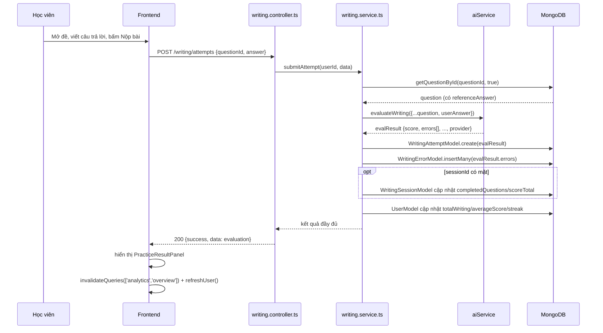

# 14 — Vòng đời một bài viết (Writing Workflow)

File này mô tả toàn bộ hành trình của **một lượt làm bài Sentence Writing**, từ lúc học viên mở đề đến lúc Analytics cập nhật — dựa đúng theo code thực tế trong `writing.service.ts`, không phải mô hình lý thuyết.

## Flow thực tế (đối chiếu trực tiếp với `writing.service.ts#submitAttempt`)

```text
User mở đề (Question Bank / AI Writing / Writing Learning Practice tab)
↓
Nhận câu tiếng Việt (KHÔNG kèm đáp án — writing.service.ts#getQuestionById(id, false))
↓
(Tùy chọn) User mở card Gợi ý — không lộ đáp án
↓
User nhập câu trả lời tiếng Anh
↓
Submit → POST /writing/attempts { questionId, answer }
↓
writing.controller.ts#submitAttempt → writing.service.ts#submitAttempt(userId, data)
↓
Backend lấy lại câu hỏi ĐẦY ĐỦ (có referenceAnswer) — getQuestionById(id, true)
↓
Backend gọi AI: aiService.evaluateWriting({vietnameseSentence, referenceAnswer, alternativeAnswers, userAnswer, level, topic, grammarTopic})
↓
AI đánh giá — aiService thử lần lượt Gemini → Groq → OpenRouter (provider nào có key), cuối cùng mới là Heuristic (xem 11-ai-system.md)
↓
Backend validate response AI (Zod schema, bên trong provider — KHÔNG validate lại ở writing.service.ts)
↓
ai.service.ts đối chiếu điểm tổng với 5 chỉ tiêu theo trọng số 40/20/20/10/10 (chỉ với provider AI; xem 11-ai-system.md § 11.6)
↓
Lưu WritingAttempt (1 document MỚI mỗi lần nộp, chứa toàn bộ evaluation và tên provider đã chấm; không ghi đè lần nộp trước)
↓
Lưu WritingError[] (nhân bản mỗi lỗi trong errors[] thành 1 document riêng, insertMany)
↓
Nếu có sessionId: cập nhật WritingSession (completedQuestions, scoreTotal, currentQuestionIndex, có thể chuyển status → COMPLETED)
↓
Cập nhật User: totalWriting += 1, averageScore = rolling average, streak = computeNextStreak(streak, lastPracticeDate) (xem bên dưới), rồi lastPracticeDate = now
↓
Return kết quả đánh giá đầy đủ về Frontend
↓
Frontend hiển thị PracticeResultPanel (điểm, lỗi, gợi ý cải thiện)
↓
queryClient.invalidateQueries(['analytics','overview']) + refreshUser() — Analytics/Dashboard cập nhật NGAY, không cần F5
```

Đây là bản dựng lại **chính xác từ source code** — không có bước "AI validate" tách riêng ở service layer (validate nằm bên trong từng provider, service chỉ nhận kết quả đã được đảm bảo đúng shape hoặc một object fallback từ Heuristic, luôn hợp lệ).

## Cách tính streak

Streak là số **ngày liên tiếp** học viên có luyện viết câu, không phải số lần nộp bài. Khi nộp một bài Sentence Writing, `writing.service.ts#submitAttempt` (cả nhánh Mongo lẫn in-memory) gọi `computeNextStreak(streak, lastPracticeDate)` trong [src/utils/streak.ts](../../src/utils/streak.ts) **trước khi** ghi đè `lastPracticeDate`:

| Tình huống | Streak mới |
|---|---|
| Chưa từng luyện viết | 1 |
| Đã nộp bài trong ngày hôm nay rồi | giữ nguyên (ít nhất 1) |
| Lần nộp trước là hôm qua | streak + 1 |
| Lần nộp trước cách từ 2 ngày trở lên | bắt đầu lại từ 1 |

"Ngày" được tính theo múi giờ **Asia/Ho_Chi_Minh** (đổi ngày lúc 00:00 giờ Việt Nam), không phụ thuộc múi giờ của máy chủ. Chỉ Sentence Writing mới cập nhật streak. Giá trị streak là giá trị đã lưu: nếu học viên nghỉ nhiều ngày thì số hiển thị giữ nguyên cho tới lần nộp bài kế tiếp (lúc đó mới về 1).

## Viết lại và so sánh các lần nộp

Học viên có thể bấm "Sửa lại & Nộp lại" và nộp lại **cùng một câu hỏi** nhiều lần. Mỗi lần nộp gọi lại đúng `POST /writing/attempts` và tạo một `WritingAttempt` mới (không upsert, không xóa lần trước), nên toàn bộ lịch sử của một câu hỏi luôn còn nguyên.

Bên dưới kết quả chấm, [PracticeResultPanel.tsx](../../client/src/user/components/PracticeResultPanel.tsx) hiển thị thêm:

- **So sánh với lần trước** ([AttemptComparisonPanel.tsx](../../client/src/user/components/AttemptComparisonPanel.tsx)): gọi `GET /writing/attempts?questionId=<id>&limit=5`, và **chỉ hiển thị khi đã có ít nhất 2 lần nộp** cho câu hỏi đó. Panel cho thấy điểm lần trước và lần này, chênh lệch từng chỉ tiêu, và các loại lỗi đã được sửa so với lần trước. Đây là màn hình chỉ đọc, không tạo dữ liệu mới.
- **Lỗi liên quan**: khi `grammarTopic` của câu hỏi là một trong 12 thì, hiện hai nút "Ôn lại {thì}" (`/learning/grammar/<slug>`) và "Quiz {thì}" (`/quiz?tense=<slug>`). Chủ điểm không phải thì (ví dụ Articles) thì không hiện nút nào, để không có liên kết chết.

`GET /writing/attempts` hỗ trợ lọc theo `questionId` ở cả nhánh Mongo lẫn in-memory (xem [10](10-api-documentation.md)).

## Sơ đồ tuần tự



## Điểm khác biệt: Paragraph Writing có flow riêng

Paragraph Writing (`paragraph.service.ts#submitAttempt`) theo đúng khuôn mẫu trên nhưng khác 2 điểm quan trọng:
1. **Không có `referenceAnswer`** — bước "lấy đáp án đầy đủ" không tồn tại, vì đoạn văn không có đáp án chuẩn cố định.
2. **Không tạo document attempt mới mỗi lần** — dùng `findOneAndUpdate({userId, topicId}, ..., {upsert:true})`, `$push` kết quả chấm mới vào `revisions[]` của **cùng một** document `ParagraphAttempt` (giới hạn giữ 30 bản gần nhất) — nộp lại bài cùng một đề không tạo bản ghi riêng biệt như Sentence Writing.
3. **Không cộng vào `User.totalWriting/averageScore/streak`** — số liệu Paragraph tách riêng qua `GET /paragraph/my-stats` (xem [17-admin-management.md](17-admin-management.md) mục Known Issues để biết đây là điểm chưa nhất quán đã ghi nhận).

## "AI đánh giá" ở bước nào, cụ thể ra sao?

Chi tiết đầy đủ (input chính xác, prompt, JSON schema, cách xử lý lỗi) đã tách ở [11-ai-system.md](11-ai-system.md) và [12-ai-writing-evaluation.md](12-ai-writing-evaluation.md) — không lặp lại ở đây để tránh sai lệch khi một trong hai tài liệu được cập nhật.
