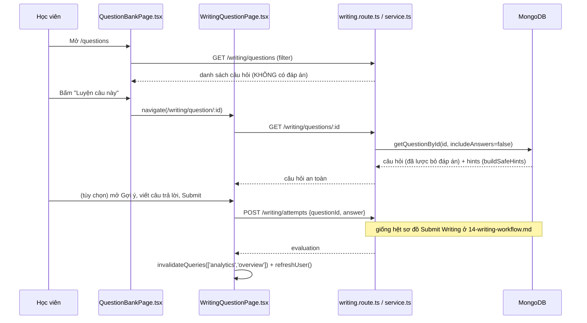
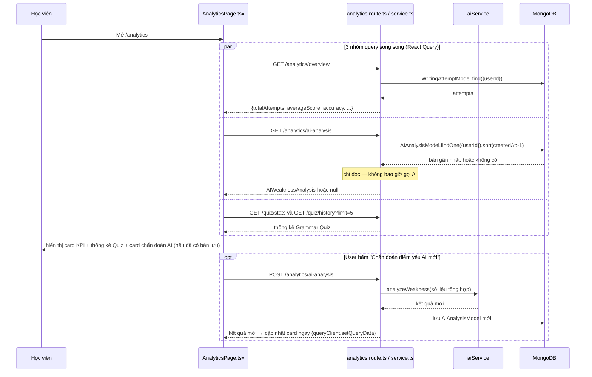
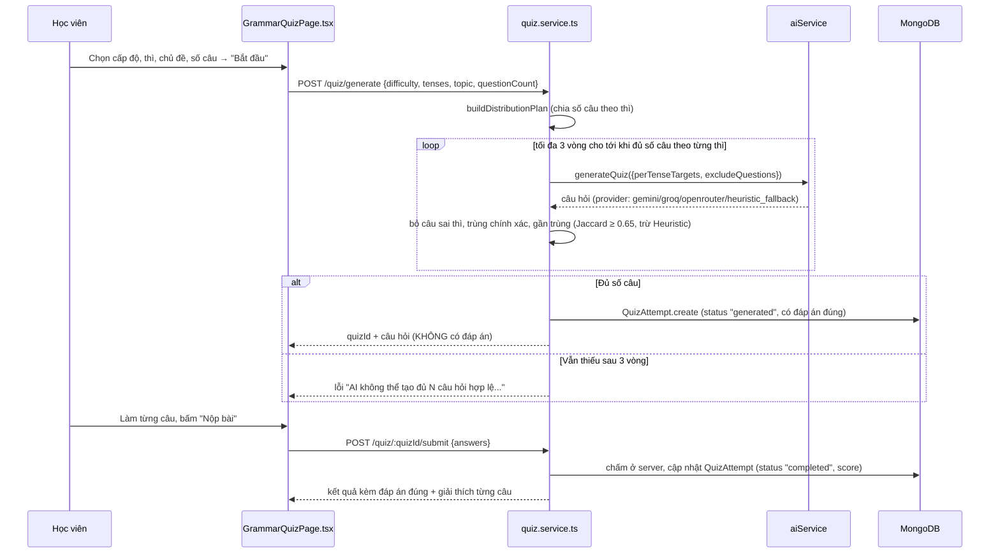

# 18 — Luồng dữ liệu (Data Flow)

Tổng hợp sequence diagram cho các luồng quan trọng nhất, dựng lại đúng theo code thực tế (không lý thuyết hóa). Với các luồng đã có diagram chi tiết ở file khác, phần này dẫn lại thay vì lặp để tránh lệch thông tin khi cập nhật.

## Login

Xem sơ đồ đầy đủ (gồm cả nhánh Admin bị từ chối 403) tại [08-authentication-and-authorization.md § Sơ đồ luồng Login](08-authentication-and-authorization.md#sơ-đồ-luồng-login-theo-code-thực-tế).

## Refresh Token

Xem sơ đồ đầy đủ tại [08-authentication-and-authorization.md § Luồng bootstrap khi tải lại trang](08-authentication-and-authorization.md#luồng-bootstrap-khi-tải-lại-trang-f5).

## Submit Writing (nộp bài + AI Evaluation)

Xem sơ đồ đầy đủ tại [14-writing-workflow.md](14-writing-workflow.md) — luồng "AI Evaluation" chính là bước ở giữa của sơ đồ này (đoạn `S->>AI: evaluateWriting(...)`), không tách thành sơ đồ riêng vì Sentence Writing không có bước nào giữa "nộp bài" và "AI đánh giá" — chúng là một lệnh gọi service duy nhất, không phải 2 luồng độc lập.

## AI Paragraph Generation

```mermaid
sequenceDiagram
    participant U as Học viên
    participant FE as ParagraphWritingPage.tsx
    participant C as paragraph.controller.ts
    participant S as paragraph.service.ts
    participant AI as aiService
    participant GP as GeminiProvider
    participant DB as MongoDB

    U->>FE: Chọn Topic + Difficulty, bấm "Tạo đề bài"
    FE->>C: POST /paragraph/generate {topic, difficulty}
    C->>S: generateAIParagraphTopic(userId, topic, difficulty)
    S->>S: map difficulty → {levelTier, minWords, maxWords} (bảng cố định)
    S->>DB: tìm tối đa 5 đề AI đã sinh gần đây (cùng user/topic/levelTier)
    DB-->>S: excludePrompts[]
    S->>AI: generateParagraphPrompt({topic, difficulty, levelTier, minWords, maxWords, excludePrompts})
    AI->>GP: generateParagraphPrompt(input)
    GP->>GP: buildParagraphGenerationPrompt(input)
    GP->>GP: gọi Gemini → parse JSON → validate Zod
    GP->>GP: looksVietnamese(promptVi)? (guard bằng code, không chỉ tin prompt)
    alt Hợp lệ
        GP-->>AI: {promptVi, requirements}
    else Lỗi/không phải tiếng Việt (thử lại tối đa 3 lần)
        AI->>AI: thử provider kế (Groq → OpenRouter); hết thì HeuristicProvider (mẫu câu cố định theo difficulty)
    end
    AI-->>S: {promptVi, requirements}
    S->>DB: ParagraphTopicModel.create({..., source:"ai_user_generated", createdBy:userId})
    DB-->>S: saved topic
    S-->>C: {topicId, promptVi, ...}
    C-->>FE: 200
    FE->>FE: navigate(/paragraph-writing/:topicId)
```

## Question Practice (duyệt Question Bank → luyện 1 câu)



## Analytics (xem thống kê + chẩn đoán AI)



## Grammar Quiz (sinh + nộp bài)



## Admin User Management (khóa/mở khóa tài khoản)

```mermaid
sequenceDiagram
    participant A as Admin
    participant FE as AdminUsersPage.tsx
    participant API as user.route.ts / service.ts
    participant DB as MongoDB

    A->>FE: Mở /admin/users
    FE->>API: GET /users/all
    API-->>FE: danh sách user (không có password)
    A->>FE: Bấm icon Khóa/Mở khóa trên 1 dòng
    FE->>API: PUT /users/:id/status
    API->>DB: user.isActive = !user.isActive; user.save()
    DB-->>API: user đã cập nhật
    API-->>FE: {isActive mới}
    FE->>FE: cập nhật state cục bộ + toast thông báo
    Note over DB: Ở request KẾ TIẾP của chính user đó,<br/>authenticate middleware tái kiểm isActive trong DB<br/>→ mất quyền truy cập NGAY, không cần đợi access token hết hạn
```
