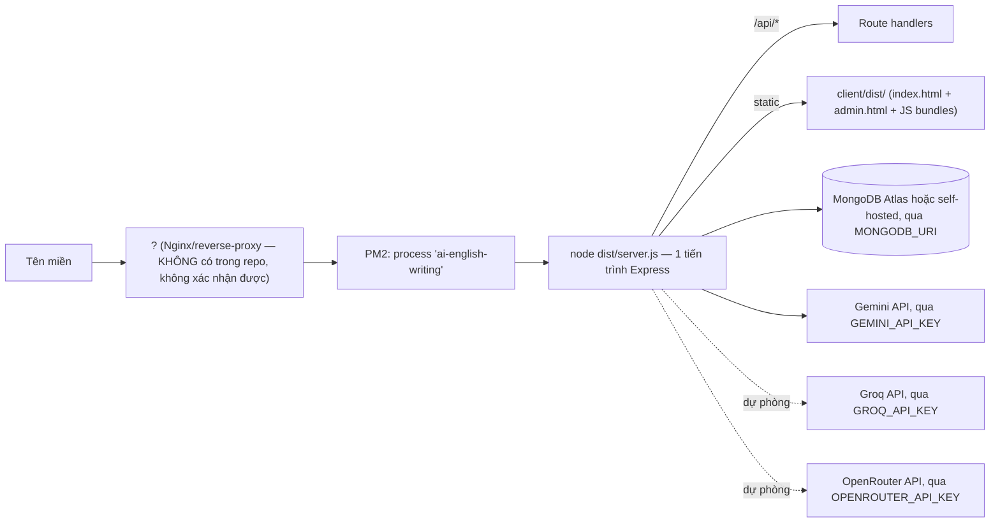

# 20 — Deployment & Runtime (+ Phân tích bảo mật)

## Chạy Local

```text
1. cp .env.example .env, điền MONGODB_URI (bỏ trống để chạy chế độ in-memory), và các API key AI muốn dùng: GEMINI_API_KEY, GROQ_API_KEY, OPENROUTER_API_KEY (bỏ trống hết để chạy hoàn toàn bằng Heuristic)
   Yêu cầu Node.js 18 trở lên (provider Groq/OpenRouter dùng `fetch` có sẵn của Node, không cài thêm thư viện HTTP)
2. npm install (cài cả root lẫn client, vì client là workspace — package.json gốc có "workspaces": ["client"])
3. npm run dev
     → chạy "npm run build:client" trước (build client/dist một lần)
     → sau đó "ts-node-dev --respawn --transpile-only src/server.ts" (backend tự reload khi sửa code)
4. Truy cập http://localhost:<PORT>/ (User) và http://localhost:<PORT>/admin (Admin) — CÙNG một server Express, không có dev-server riêng cho client trong workflow thực tế của dự án này (client/vite.config.ts có cấu hình `server.proxy` cho `npm run dev` bên trong thư mục `client/`, nhưng script `dev` ở root không dùng cách đó — nó build client tĩnh rồi phục vụ qua Express, giống hệt production)
```

MongoDB, AI: nếu không có MongoDB local, hệ thống tự chuyển sang `memoryStore.ts` (log: "Operating with in-memory store & preloaded CEFR curriculum"; riêng Paragraph Writing, Writing Learning và Grammar Quiz cần Mongo). Provider AI nào thiếu key thì bị bỏ qua (Gemini thiếu key: log "GEMINI_API_KEY not configured. Gemini will be skipped."); nếu không có provider AI nào, hệ thống chạy bằng `HeuristicProvider` (log: "No AI provider configured (Gemini/Groq/OpenRouter). Using Heuristic Rule Engine Provider only."). Khi có provider, log khởi động cho biết thứ tự thử, ví dụ "AI provider order: gemini → groq → openrouter → heuristic_fallback".

## Production

Theo đúng [deploy.sh](../../deploy.sh):

```text
git pull origin main
npm ci (hoặc npm install nếu chưa có package-lock.json)
npm run build
  → npm --prefix client run build   (tsc -b && vite build → sinh client/dist/index.html, admin.html, 2 bundle JS)
  → tsc                              (biên dịch src/ → dist/)
pm2 start/restart "ai-english-writing" chạy `npm start` (= node dist/server.js)
pm2 save
```

Một tiến trình Node.js/Express duy nhất (quản lý bởi PM2) phục vụ **cả API lẫn 2 bundle SPA tĩnh** — không có tiến trình Nginx/reverse-proxy nào được cấu hình trong repository này (không tìm thấy file `nginx.conf`/tương đương). Nếu có Nginx đặt trước PM2 trong hạ tầng thực tế, cấu hình đó nằm **ngoài phạm vi repo này**, không thể xác nhận chi tiết.



## Biến môi trường (`.env`, đối chiếu [.env.example](../../.env.example) và [src/config/env.ts](../../src/config/env.ts))

| Biến | Ý nghĩa | Mặc định nếu bỏ trống |
|---|---|---|
| `PORT` | Cổng Express lắng nghe | `5000` trong `config/env.ts`, nhưng `server.ts` tự đọc `process.env.PORT` với fallback `3000` — **hai nơi có 2 giá trị mặc định khác nhau** (không ảnh hưởng nếu `PORT` luôn được set trong `.env`, nhưng là điểm không nhất quán nhỏ) |
| `MONGODB_URI` | Chuỗi kết nối MongoDB | Bỏ trống → chạy in-memory |
| `JWT_SECRET` | Secret ký access token | Có fallback hardcode trong code — **phải đổi ở production** |
| `JWT_EXPIRES_IN` | Thời hạn access token | `15m` |
| `REFRESH_TOKEN_SECRET` | Secret hash refresh token | Có fallback hardcode — **phải đổi ở production** |
| `REFRESH_TOKEN_EXPIRES_IN_DAYS` | Thời hạn refresh token | `30` |
| `ADMIN_EMAIL` / `ADMIN_PASSWORD` | Bootstrap 1 tài khoản admin đầu tiên | Bỏ trống → không tự tạo admin nào |
| `AI_PROVIDER` | `"gemini"` để bật Gemini | `"gemini"` |
| `GEMINI_API_KEY` | API key Gemini | Bỏ trống → bỏ qua Gemini |
| `GEMINI_MODEL` | Model Gemini ưu tiên | `"gemini-3.6-flash"` |
| `GEMINI_REQUEST_TIMEOUT_MS` | Timeout mỗi lời gọi Gemini (code chặn trần 6000ms, áp dụng cả cho Groq/OpenRouter) | `10000` → thực tế 6000 |
| `GROQ_API_KEY` / `GROQ_MODEL` | Provider dự phòng Groq | Bỏ trống key → bỏ qua Groq; model mặc định `"openai/gpt-oss-20b"` |
| `GROQ_REASONING_EFFORT` | Mức suy luận `low`/`medium`/`high` cho model `gpt-oss` trên Groq | `low` |
| `OPENROUTER_API_KEY` / `OPENROUTER_MODEL` | Provider dự phòng OpenRouter | Bỏ trống key → bỏ qua OpenRouter; model mặc định `"openai/gpt-oss-20b"` (model trả phí) |
| `AI_EVALUATION_TEMPERATURE` | `temperature` khi chấm bài trên Groq/OpenRouter (0–2) | `0.2` |
| `AI_PRIMARY_ORDER` | Thứ tự thử provider AI, phân tách bằng dấu phẩy | `gemini,groq,openrouter` |
| `NODE_ENV` | `"production"` để bật cookie `secure: true` | `"development"` |

Không ghi giá trị thật của bất kỳ secret nào trong tài liệu này, đúng yêu cầu.

## NPM Scripts (root `package.json`)

| Script | Việc thực hiện |
|---|---|
| `npm run dev` | build client 1 lần + chạy backend bằng `ts-node-dev --respawn` |
| `npm run build:client` | `npm --prefix client run build` |
| `npm run build` | build client + `tsc` biên dịch backend |
| `npm run lint` | `tsc --noEmit` (chỉ typecheck, không có ESLint ở root) |
| `npm start` | `node dist/server.js` |

Client có script riêng: `npm --prefix client run lint` chạy `oxlint`.

---

## Phân tích bảo mật (Security Analysis)

| Hạng mục | Trạng thái | Ghi chú |
|---|---|---|
| Password hashing | **Đang triển khai** | bcrypt, cost 10, không bao giờ trả `password` ra ngoài response |
| Access token (JWT) | **Đang triển khai** | Thời hạn ngắn (15 phút mặc định), giữ trong RAM phía client, không bao giờ ghi `localStorage` |
| Refresh token | **Đang triển khai** | Token thật là chuỗi ngẫu nhiên 48 byte, chỉ hash được lưu DB, rotation mỗi lần refresh, có thể thu hồi qua `revokedAt` |
| Cookie HttpOnly | **Đang triển khai** | `httpOnly: true` (JS không đọc được), `secure` bật khi `NODE_ENV=production`, `sameSite: 'lax'`, `path` giới hạn `/api/auth` |
| Cách ly phiên User/Admin | **Đang triển khai** | Cookie tên khác nhau, endpoint khác nhau — xem [08](08-authentication-and-authorization.md) |
| CORS | **Có, nhưng cần cân nhắc thêm** | `cors({ origin: (origin, cb) => cb(null, origin \|\| true), credentials: true })` trong `app.ts` — phản chiếu (reflect) **bất kỳ origin nào** gửi lên thay vì whitelist cụ thể. Đây là cách phổ biến để cookie credentialed hoạt động qua nhiều domain preview/staging, nhưng đồng nghĩa **mọi origin** đều được phép gọi API kèm cookie — nên cân nhắc giới hạn danh sách domain cụ thể ở production nếu miền không thay đổi thường xuyên |
| Authentication middleware | **Đang triển khai** | `authenticate` tái kiểm `isActive` trong DB mỗi request, không chỉ tin JWT |
| Authorization (role) | **Đang triển khai** | `authorize("admin")` áp dụng nhất quán cho mọi route quản trị |
| Validate input | **Đang triển khai (phần lớn)** | Zod schema cho mọi route nhận body ghi dữ liệu quan trọng (auth, writing attempts, paragraph, learning). Một số route đọc (GET) nhận `req.query` không qua `validateQuery` (ví dụ `writing.service.ts#getQuestions` tự ép kiểu `Number(query.limit)` thủ công) — không phải lỗ hổng nghiêm trọng vì chỉ ảnh hưởng dữ liệu đọc, nhưng chưa đồng nhất với các route khác |
| AI API key | **Đang triển khai đúng cách** | `GEMINI_API_KEY`, `GROQ_API_KEY`, `OPENROUTER_API_KEY` chỉ đọc ở backend (`config/env.ts`), không bao giờ gửi xuống Frontend hay ghi vào log dưới bất kỳ hình thức nào |
| Biến môi trường / secrets | **Đang triển khai, nhưng có fallback hardcode đáng chú ý** | `JWT_SECRET`/`REFRESH_TOKEN_SECRET` có giá trị mặc định hardcode ngay trong `config/env.ts` nếu biến môi trường trống — an toàn cho dev, **rủi ro nếu vô tình chạy production mà quên set `.env`** |
| Bảo vệ đáp án (reference answer) | **Đang triển khai, đã xác minh kỹ** | Xem [12-ai-writing-evaluation.md](12-ai-writing-evaluation.md) — `getQuestionById(id, false)` là nhánh duy nhất Frontend công khai đi qua, luôn lược bỏ đáp án ở cả 2 tầng (Mongo/in-memory) |
| MongoDB security | **Chưa có trong repo, phụ thuộc hạ tầng** | Không có cấu hình TLS/IP whitelist/auth trong code — hoàn toàn phụ thuộc chuỗi kết nối `MONGODB_URI` và cấu hình phía nhà cung cấp MongoDB (ví dụ Atlas), nằm ngoài phạm vi source code |
| Rate limiting | **Có, nhưng giới hạn** | Chỉ áp dụng cho route gọi AI, lưu trong bộ nhớ tiến trình (không phân tán — xem [17](17-admin-management.md) #6); các route khác (login, register,...) **không có rate limit** — [NOT IMPLEMENTED] cho brute-force login protection |
| HTTPS | **Chưa có trong repo** | `NODE_ENV=production` chỉ bật cờ `secure` cho cookie; việc chấm dứt TLS (terminate HTTPS) không nằm trong code Express này — phụ thuộc hạ tầng đặt trước nó |
| Helmet | **Đang triển khai (một phần)** | `helmet()` bật nhưng `contentSecurityPolicy: false` — tắt CSP có chủ đích (thường vì SPA cần load script/style linh hoạt), các header bảo vệ khác của Helmet (X-Frame-Options, v.v.) vẫn hoạt động |
